# System Emulation & QoS Benchmark Infrastructure

Automated end-to-end hardware emulation and Quality of Service (QoS) evaluation infrastructure for the **Face Detection & Mitsubishi FX5U Assembly Station SCADA**.

Since the physical station has been decommissioned, this infrastructure provides multi-node distributed emulation to validate communication integrity, network latency, PLC scan-reaction performance, and jitter under high-rate load.

---

## 1. Multi-Node Emulation Topology

```mermaid
graph TD
    subgraph Host ["Emulated Distributed System"]
        HMI["Virtual PC Face Recognition HMI<br>Workload Generator"]
        ESP32["Virtual ESP32 Protocol Bridge<br>Core 0 HTTP :8080 &#124; Core 1 Modbus :5503"]
        PLC["Virtual Mitsubishi FX5U PLC Client<br>10ms Cyclic Scan Loop"]
        RenodeNode["Renode Virtual Controller<br>Cortex-M Node :15503"]
    end

    HMI -->|HTTP REST: /action, /status, /user_detection| ESP32
    PLC ===|Modbus TCP Client: Coils 112-116, 208-210| ESP32
    RenodeNode -.->|TCP Socket Bridge| HMI
```



1. **Virtual ESP32 Bridge (`VirtualESP32Bridge`)**:
   - Emulates the dual-core FreeRTOS architecture.
   - Core 0 runs an HTTP REST server on port `8080` with full parameter validation and CORS headers matching `web_server.cpp`.
   - Core 1 runs a Modbus TCP server on port `5503`.
   - Simulates microsecond-level atomic inter-core synchronization, clears conflicting momentary command coils (`112–115`) upon new command arrival, and manages 500 ms coil pulse timeouts.
2. **Virtual Mitsubishi FX5U PLC (`VirtualMitsubishiPLC`)**:
   - Implements a 10 ms cyclic ladder scan loop over Modbus TCP.
   - Reads command coils 112 (`START`), 113 (`STOP`), 114 (`EMG`), 115 (`RESET`), and 116 (`USER_DETECTED`).
   - Enforces safety-dominant industrial ladder priority (`Emergency -> Reset -> Stop -> Start`) and writes machine status coils 208 (`STS_RUNNING`), 209 (`STS_STOPPED`), and 210 (`STS_EMG`).
3. **Virtual HMI & Workload Generator (`VirtualHMIClient`)**:
   - Emulates operator face recognition authentication and issues operational cycles (`start`, `stop`, `emergency`, `reset`).
   - Measures packet delivery ratio, round-trip time (RTT), internal ESP32 processing latency, and chronological jitter.
4. **Renode Hardware Emulation (`RenodeController` + `plc_node.resc`)**:
   - Spawns headless Renode (`C:\Tools\renode\renode.exe`) with socket bridging on port `15503`.

---

## 2. Running the Emulation & Benchmark

Run with `just` or directly via Python:

```powershell
# Run 50-cycle end-to-end QoS evaluation (6 functional verification + 50 stress cycles = 56 transactions)
just emulate-qos samples="50"

# Or invoke the emulator directly:
python Emulation/system_emulator.py 50

# Run headless Renode controller test
just emulate-renode
```

---

## 3. Emulated QoS Benchmark Results (`qos_report.csv` / `timings_emulated.csv`)

| Metric | Result | Benchmark Target | Status |
| :--- | :---: | :---: | :---: |
| **Total Transactions Evaluated** | **56** (6 Phase 2 + 50 Phase 3) | >= 50 | PASS |
| **Packet Delivery / Success Rate** | **100.00%** | > 99.0% | PASS |
| **HTTP RTT Duration (Min)** | **0.93 ms** | < 50 ms | PASS |
| **HTTP RTT Duration (Mean)** | **17.00 ms** | < 100 ms | PASS |
| **HTTP RTT Duration (Median / P50)** | **12.10 ms** | < 100 ms | PASS |
| **HTTP RTT Duration (P95)** | **26.04 ms** | < 100 ms | PASS |
| **HTTP RTT Duration (P99)** | **26.22 ms** | < 150 ms | PASS |
| **HTTP RTT Duration (Max)** | **26.22 ms** | < 200 ms | PASS |
| **RTT Std Dev** | **7.55 ms** | < 25 ms | PASS |
| **RTT Jitter (Mean Chronological Delta)** | **7.96 ms** | < 10 ms | PASS |
| **ESP32 Internal Bridge Latency** | **3.9 μs** | < 50 μs | PASS |
| **PLC Cyclic Scan Cycle** | **10.0 ms** | 10.0 ms | PASS |

> [!NOTE]
> Detailed per-transaction timing telemetry is saved to `Interface/Timings_log/timings_emulated.csv` and `Emulation/logs/qos_report.csv` following the historical format in `timings.csv`.
