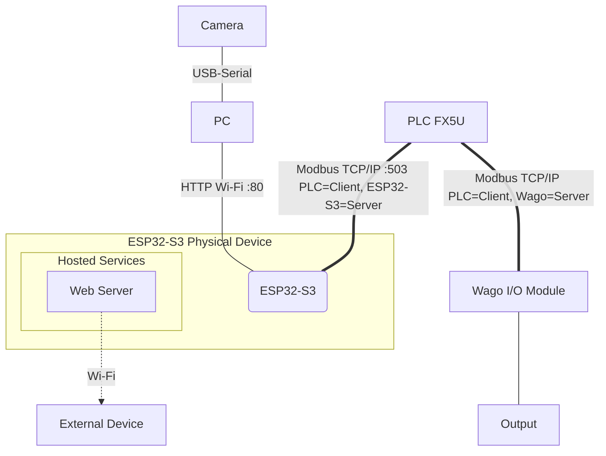
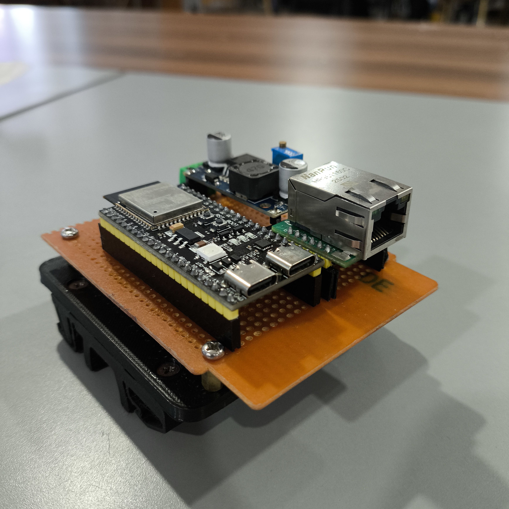
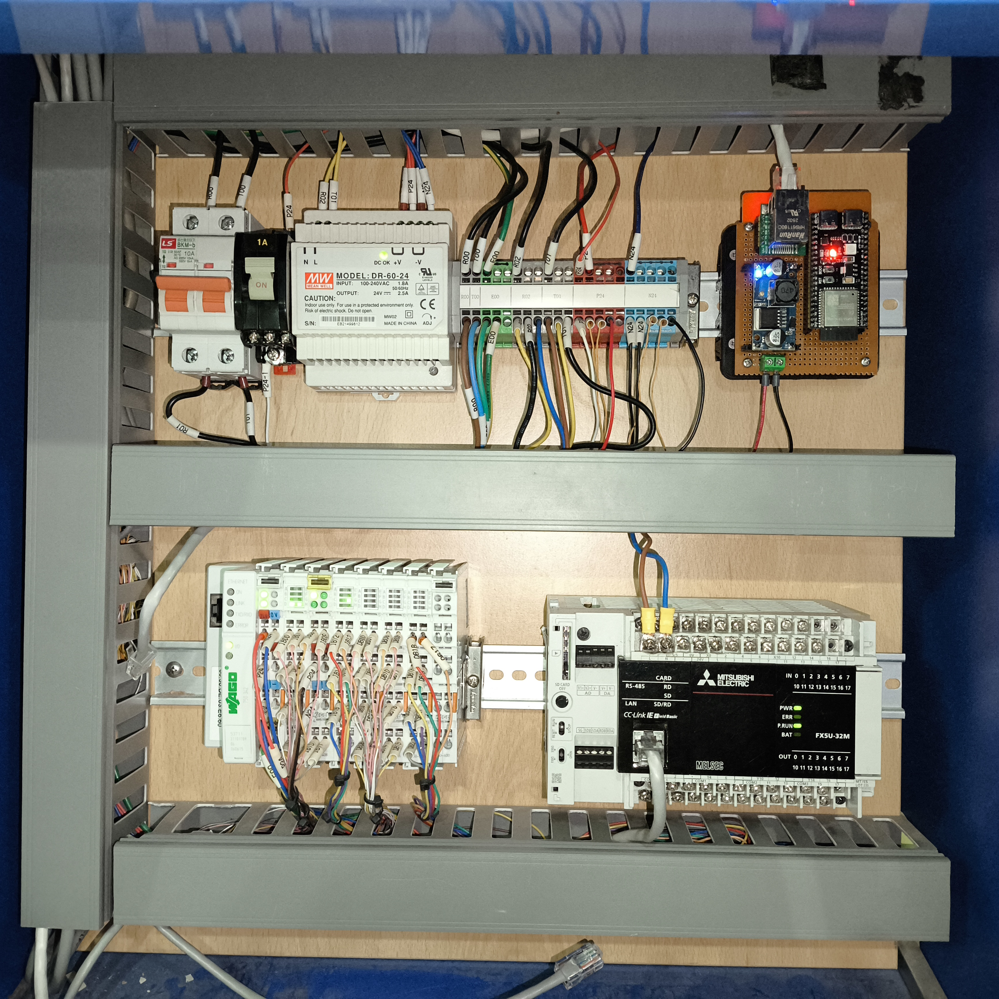

# PBL-MK2025055SB001 - Face Detection & Assembly Station SCADA

Project-Based Learning (PBL) repository for a SCADA prototype built around the
**Assembly Station** at Politeknik Negeri Batam (POLIBATAM). The system uses an
**ESP32-S3** and a **Mitsubishi FX5U PLC** as the main components, communicating
over **Modbus TCP/IP** through a W5500 Ethernet module, with a PC-based face
recognition interface acting as the human-machine interface (HMI) and access
controller.

The main objective is to develop an automatic control & monitoring system for
the Assembly Station that:

- Can be accessed over **Wi-Fi** by external devices (PC, mobile, HMI).
- Talks to the **FX5U PLC** via **Modbus TCP/IP** through the ESP32 (Modbus
  server on port 503).
- Performs **face recognition** on the PC (OpenCV/LBPH) and only allows
  authorized operators to start the machine.
- Provides a web HMI with live video feed, status indicators, and start/stop/\
  emergency/reset controls.
- Uses a modern **CMake + Ninja + Xtensa GCC 16.1.0** cross-compilation toolchain
  and host **CTest** simulation harness with zero dependency on PlatformIO or Arduino IDE.

## Repository Layout

| Path | Description |
| --- | --- |\
| `Electrical-Schematics/` | KiCad project and rendered images of the electrical wiring (ESP32-S3 + W5500 + PLC I/O). |
| `ESP32-Program/` | Modular C++17 firmware for the ESP32-S3 (CMake + Ninja + Xtensa GCC 16.1.0 + FreeRTOS + Modbus TCP + CTest host suite). |
| `Emulation/` | Multi-node hardware emulation (Virtual ESP32 Bridge, Virtual FX5U PLC, Virtual HMI, Renode) & QoS benchmark suite. |
| `Interface/` | Python (Flask + OpenCV) face-recognition HMI, web front-end, and empirical timing logs (`Timings_log/`). |
| `justfile` | Root task runner orchestrating firmware builds, CTest unit tests, multi-node QoS emulation, and flashing. |
| `test_results.md` | Comprehensive test report compiling CTest unit tests, physical hardware baseline logs, and multi-node emulation QoS metrics. |
| `README.md` | High-level system architecture, repository layout, and quick-start guide. |

## System Architecture


## System Overview

1. **Interface (PC)** runs a Flask web app (`Interface/app.py` or `Interface/AppImproved.py`) that:
   - Captures the webcam feed and detects faces using Haar cascade.
   - Recognizes the operator using an LBPH model (`trainer/trainer.yml`).
   - On authorized detection, sends HTTP commands to the ESP32
     (`/action?type=start|stop|emergency|reset`) and updates `/user_detection?detected=1|0`.
2. **ESP32-S3** (`ESP32-Program/App/Src/main.cpp`) runs the Modbus bridge & REST gateway:
   - **Wi-Fi & REST API (Core 0)** — receives commands from the PC interface on port 80.
   - **W5500 Ethernet & Modbus TCP server (Core 1)** — serves Modbus TCP on port 503, writes momentary command coils read by the FX5U PLC, and reads status feedback coils from the PLC.
3. **Mitsubishi FX5U PLC** is the Modbus TCP client that controls the Assembly
   Station actuators based on the ESP32 coils.

See the [System Architecture](#system-architecture) section for the full block diagram and the per-directory
`README.md` files for component-level details.

## Quick Start

1. Test, emulate, and flash the firmware using the modern toolchain (`just` + CMake + Ninja + Xtensa GCC / MinGW Clang):
   ```bash
   just test                     # Run host CTest unit test suite (0.04s)
   just build-release            # Cross-compile native ESP32-S3 ELF & firmware.bin
   just emulate-qos samples="50" # Run multi-node SCADA & PLC QoS emulation
   just diag-esptool             # Run silicon flash & security diagnostics on COM10
   just flash-esptool            # Flash ESP32-S3 over UART via uvx esptool @ 921600 baud
   just monitor                  # Serial monitor @ 921600 baud via uvx pyserial
   ```
2. Train the face model from the PC interface:
   ```bash
   cd Interface
   python 01_Ambil_Wajah.py   # capture dataset into dataset/
   python 02_training.py      # train -> trainer/trainer.yml
   ```
3. Launch the web HMI:
   ```bash
   python app.py              # http://<PC-IP>:5000
   ```
4. Configure the PLC (FX5U) Modbus TCP client to connect to the ESP32 Ethernet
   IP (`192.168.1.50:503`) and read/write the coils listed in
   `ESP32-Program/App/Inc/app_config.hpp`.

## Finished Product & Implementation


